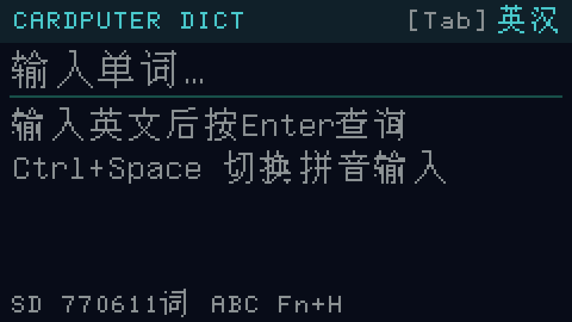

# CardputerDict 0.6.4

M5Stack **Cardputer / Cardputer-Adv** 通用离线词典与中文维基百科阅读器。启动自动识别设备，支持中文拼音、英汉/汉英查词、IPA音标、简繁字形回退和英语单词朗读。查词与百科阅读无需联网或PSRAM。



## 下载

**固件和大词库均在 [GitHub Releases v0.6.4](https://github.com/RadioDisney/CardputerDict/releases/tag/v0.6.4)。** 本仓库的源码ZIP不含完整词库或百科；不要把源码ZIP当成SD数据包。

| 文件 | 用途 |
|---|---|
| `CardputerDict-0.6.4-merged.bin` | 新机完整烧录，地址 **0x0**，ESP32-S3 / 8MB Flash |
| `CardputerDict-0.6.4-app.bin` | 已有同分区固件升级，地址 **0x10000**，保留WiFi/音量设置 |
| `CardputerDict-0.6.4-SD-dictionaries.zip` | 英汉、汉英、拼音数据和许可证，约24MB压缩 / 62MB解压 |
| `CardputerDict-Wikipedia-zh-20261101-part-1-of-5.zip` 至 `part-5-of-5.zip` | 完整中文维基，**五个ZIP全部需要**，合计约1.94GB压缩 / 5.15GB解压 |
| `data-assets.json`、`SHA256SUMS.txt` | 文件清单、长度和SHA-256校验值 |

M5Burner中分别提供 **Cardputer** 和 **Cardputer ADV** 条目，使用同一通用合并镜像。烧录完整镜像会重置片内WiFi和音量设置；SD文件保留。固件内只有29词演示，完整功能需要以下SD数据安装。

## SD卡要求与安装

- 使用 **FAT32**，不要exFAT。仅英汉/汉英数据很小；完整百科加词库约 **5.21GB**，至少8GB卡，建议16GB或32GB，并预留至少5.3GB空闲。8GB FAT32已实机验证。
- 更大容量卡也需FAT32。格式化会清空卡，请先自行备份；本工具不会格式化卡。
- 下载、解压建议在Mac/PC上进行，解压后的目录再复制到SD，不要把压缩包直接放卡上。

### 手动安装

1. 从上面的Release下载并解压 `CardputerDict-0.6.4-SD-dictionaries.zip`。
2. 需要百科时，下载五个维基ZIP，**依次全部解压到同一个准备目录**。它们是五个独立ZIP，不需要拼接文件；少任何一个都不是完整包。
3. 将准备目录中的 `dictionaries/`、`licenses/`、`audio/`，以及可选的 `wikipedia/` 复制到SD根目录。不要在卡上再套一层准备目录。
4. 若已有旧 `wikipedia/`，先将整个旧目录改名备份，再安装新目录；不要混用测试包与完整包。
5. 安全推出卡，将设备完全关机后插卡，再开机。首次原词库索引可能约1分钟，之后使用缓存；百万维基索引已在电脑生成，不在开机时全库扫描。

```text
SD根目录/
  dictionaries/  ecdict.{ifo,idx,dict}, cedict.{ifo,idx,dict}, pinyin.{ifo,idx,dict}
  licenses/      数据和字体许可证
  audio/         en/个人音频，cache/en/按需发音缓存
  wikipedia/     wiki.wki, index.wix, titles.wit, text00000.bin ... text00036.bin
                 manifest.json, LICENSE.txt
```

### 自动下载并校验

在源码目录用Python 3运行，无需安装额外依赖。输出目录须为新目录：

```sh
# 完整英汉/汉英 + 中文维基；约需8GB以上电脑空闲空间保存压缩与解压数据
python3 tools/download_release_data.py --release v0.6.4 --wikipedia --output ../Cardputer-SD

# 只下载英汉/汉英/拼音
python3 tools/download_release_data.py --release v0.6.4 --output ../Cardputer-dictionaries
```

工具支持下载断点续传，按SHA-256校验后解压，拒绝覆盖已有目标目录。下载缓存保留在 `build/release-data-downloads/`。将输出目录里的内容复制到FAT32卡根目录。

通过读卡器安装百科并逐文件回读校验（将CARD替换为实际卷名）：

```sh
python3 tools/install_wikipedia.py ../Cardputer-SD/wikipedia --sd-root /Volumes/CARD
```

它先写临时目录，校验完成后切换；旧百科目录会作为备份保留，不修改词典或音频。更多格式、转换与验证方法见 [百科说明](docs/WIKIPEDIA.md)。

## 操作

| 按键 | 操作 |
|---|---|
| Tab / Shift+Tab | 根据SD已安装词库正向 / 反向循环；标准数据包为英汉 → 汉英 → 百科 |
| Ctrl+Space | 拼音 / 直接输入，保持当前词库 |
| 字母 | 英文或中文全拼，如 `pingguo`、`nihao`；v代表ü |
| 空格、1–9 | 选当前页拼音候选；Enter打开词条/文章 |
| ↑ / ↓ | 直接选词、阅读上一页 / 下一页，无需Fn |
| ← / → | 阅读前后翻页；拼音编辑时翻候选，`[` / `]`仍可用 |
| Fn+方向键 | 输入原标点 `; . , /`；加Shift输入 `: > < ?` |
| Space / Enter | 阅读下一页；所有阅读翻页首尾循环 |
| Backspace / 反引号 | 删除字符 / 返回；Fn+Backspace清空 |
| Fn+P | 英语词典词条朗读 / 停止；Fn+=、Fn+-调音量 |
| Fn+W | 在设备输入2.4GHz WiFi；密码不需要上传到电脑 |
| Fn+H / G0 | 帮助 |
| Fn+R / Fn+Shift+R | 重载SD缓存 / 强制重建原词库索引 |

当前SD仅保留英汉、汉英和百科，拼音是输入辅助，不参与独立切换。以后添加其他StarDict可自动加入Tab列表；Fn+E、Fn+D不再切换词库。左上始终显示 `CARDPUTER DICT`。

英文朗读优先播放 `audio/en/<word>.mp3|wav`，其次读缓存；缺少音频且配置WiFi时通过验证HTTPS向 `dict.youdao.com` 发送所选英文词并获取发音，完成后关闭WiFi。第三方接口可用性可能变化。本仓库与Release不附第三方录音包；百科不提供中文整篇朗读。

## 数据范围与限制

- ECDICT：770,611个英文词头；CC-CEDICT派生汉英：198,650个简繁词头；拼音：85,610种整词代码。
- 中文维基：官方 **2026-11-01** 快照，**1,563,854篇主命名空间正文、4,863,298个标题/简繁别名/有效重定向**。474个无效或循环/跨命名空间重定向未加入标题索引。
- 按标题前缀检索，不是正文全文搜索。正文是无图纯文字整理，已转简体；复杂模板/Lua不能完全展开，个别格式参数可能残留，数学公式和表格排版不等同网页版。生僻/扩展区字受字体覆盖限制。
- 正文按128MiB分片、64位位置读取；无12KB文章截断，固定小缓冲，已验证实际超过4GB位置、跨分片和长文末页。首次从长文首页跳末页需定位，按反引号可取消。

## 构建与测试

```sh
python3 -m platformio run -e cardputer
python3 -m platformio run -e cardputer -t upload --upload-port /dev/cu.usbmodemXXXX
sh tools/test.sh
```

依赖锁定M5GFX/M5Unified 0.3.0、M5Cardputer 1.1.1；8MB Flash、6MB应用分区，横屏240×135、rotation=0。无OTA。普通版GPIO矩阵/NS4168，Adv TCA8418/ES8311由设备识别选择。

大数据不进入Git索引，源码ZIP仅含小型测试fixture、许可证及转换工具；需要真实词库测试时先从Release下载到本地 `sdcard/dictionaries/`。维基转换依赖单独安装：

```sh
python3 -m venv .venv-wiki
.venv-wiki/bin/python -m pip install -r tools/requirements-wiki.txt
.venv-wiki/bin/python -m unittest discover -s tests -p 'test_*.py' -v
```

设备验证记录见 `docs/validation-v060/` 至 `docs/validation-v064/`。字体、方向键、索引、UTF-8、缓存、长文与清理保护的主机测试使用ASan/UBSan。

## 来源与许可

应用原创代码MIT。ECDICT MIT；MDBG/CC-CEDICT派生汉英与词组拼音按CC BY-SA 4.0；中文维基正文按CC BY-SA 4.0，每篇保留来源版本URL和历史/作者链接；mozillazg/pinyin-data MIT。字体、dr_mp3与其他依赖遵循各自许可，见 [third_party](third_party) 与 [sdcard/licenses](sdcard/licenses)。Release数据包包含相应许可证与来源说明。
